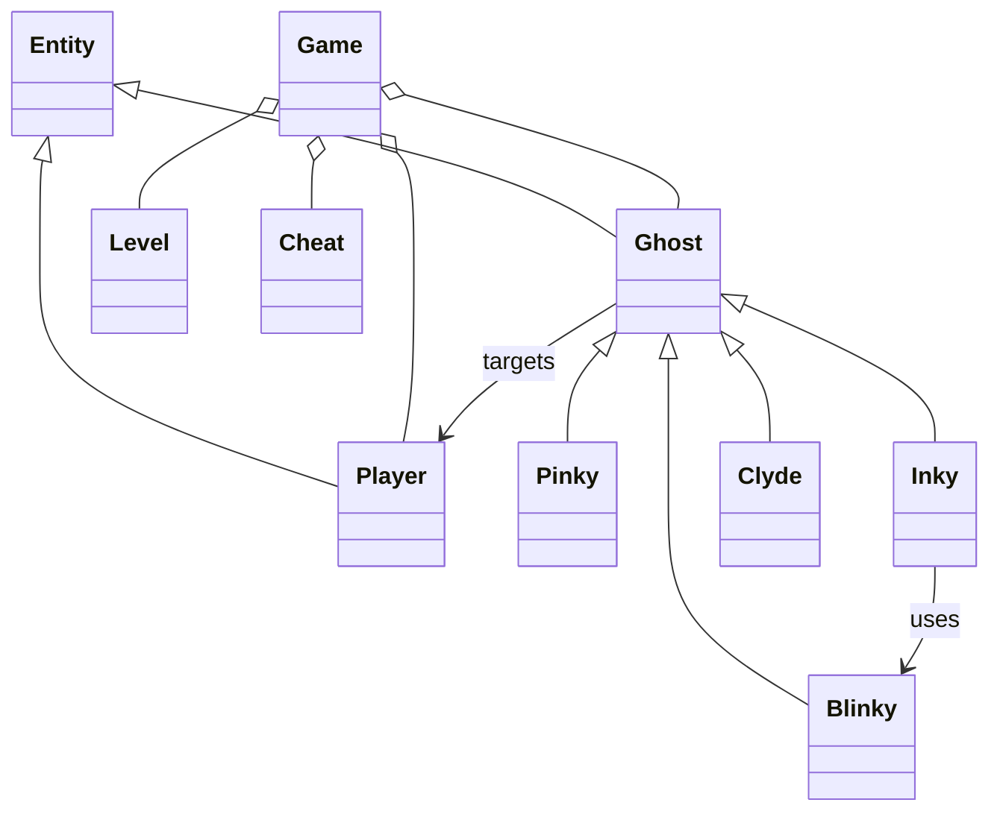

*This project has been created as part of the 42 curriculum by repichan, niverdie*

# Pac-Man — Ghosts! More ghosts!

## Description

A Python remake of the 1980 arcade classic. Pac-Man runs through procedurally
generated mazes, eats every pacgum to clear the level, and avoids four ghosts
that each hunt him in their own way. Super-pacgums turn the tables for a few
seconds: ghosts become edible and flee.

Main features:

- At least 10 levels: level 1 uses a fixed seed, the next ones are random.
- Four ghosts with distinct, arcade-inspired AI (Blinky, Pinky, Inky, Clyde).
- Lives, score, per-level time limit.
- Persistent top-10 highscores with player name entry.
- Cheat mode to help reviewers test every feature.
- JSON configuration file (with `#` comments) and safe defaults.

## Instructions

Requirements: Python 3.13 and [uv](https://docs.astral.sh/uv/).

```sh
make install    # create the virtual environment and install dependencies
make run        # launch the game
make debug      # launch with debug output
make lint       # flake8 + mypy
make clean      # remove caches and build artifacts
make build      # TODO: build the standalone package
```

The game reads `config.json` at the root of the repository (see
[Configuration](#configuration)).

TODO: link to the itch.io page.

### Controls

| Key | Action |
|---|---|
| Arrow keys / WASD | Move Pac-Man |
| TODO | Pause |
| TODO | Toggle cheat mode |

### Cheat mode

Cheats only work once cheat mode is on. Turning cheat mode off also turns off
every active cheat.

| Key | Cheat |
|---|---|
| TODO | Invincibility: ghosts cannot kill Pac-Man |
| TODO | Ghost freeze: ghosts and the level timer stop |
| TODO | Always edible: ghosts stay edible and flee |
| TODO | Skip level: the current level counts as won |
| TODO | Extra life: +1 life |
| TODO | Speed boost: Pac-Man moves two cells per turn |

## Configuration

`config.json` is standard JSON in which lines starting with `#` are comments.
It is validated with Pydantic.

```json
{
    "seed": 42,
    "highscore_filename": "save_data",
    "rules": {
        "lives": 3,
        "pacgum": 42,
        "point_per_pacgum": 10,
        "point_per_super_pacgum": 50,
        "point_per_ghost": 200
    },
    "game_specs": [
        {"level": 1, "width": 15, "height": 15, "level_max_time": 90}
    ]
}
```

| Key | Meaning | Default |
|---|---|---|
| `seed` | Seed of level 1. An int, or any string (converted to a stable int). | TODO |
| `highscore_filename` | File where highscores are saved. | TODO |
| `rules.lives` | Lives at game start. | TODO |
| `rules.point_per_pacgum` | Points for a pacgum. | TODO |
| `rules.point_per_super_pacgum` | Points for a super-pacgum. | TODO |
| `rules.point_per_ghost` | Points for an edible ghost. | TODO |
| `game_specs` | List of levels: `width`, `height`, `level_max_time` (seconds). | TODO |

If `game_specs` describes fewer than 10 levels, the missing levels reuse the
last entry with a new random maze. If it describes more, they are all played.

TODO: invalid / missing values handling (clamp, default, log message).

## Highscore

TODO: storage format and location, loading at start, saving at the end.

Every entry is validated by a Pydantic model (`HighscoreEntry`):

- name: surrounding spaces stripped, 1 to 10 characters, ASCII letters, digits
  and spaces only;
- score: non-negative integer.

The same model is used to type the name on the end screens (invalid keys are
simply ignored) and to read the highscore file back, so a corrupted entry is
detected instead of crashing the game.

## Maze Generation

Mazes come from the assigned A-Maze-ing package (`mazegenerator` 2.1.0),
used as-is:

```python
MazeGenerator(size=(width, height), perfect=False, seed=seed).maze
```

- `perfect=False` gives a braided maze (no dead ends except next to the "42"
  pattern), which suits Pac-Man chases.
- The result is a grid `grid[y][x]` of 4-bit wall masks: N=1, E=2, S=4, W=8.
  A value of 15 is a closed cell of the "42" pattern.
- `build_level(config, number)` picks the level specs, chooses the seed and
  wraps any generator failure in a clear error message.
- Seeds: level 1 uses the config seed; the generator only accepts positive
  ints, so `to_int_seed` converts digit strings to ints and any other string
  (or a non-positive int) to a stable positive int with
  `random.Random(seed)`. Other levels use seed `0`, i.e. a random maze.

From the grid, `Level` places a pacgum on every cell except the "42" cells,
the four super-pacgums in the corners, the four ghost spawns in the corners and
Pac-Man's spawn in the middle (shifted right if the middle is a "42" cell).

## Implementation

**Turn-based logic.** The game logic advances in turns: on each turn every
entity moves by one cell. The main loop calls `Game.turn()`
`TURN_PER_SECOND` times per second (8) while rendering at a higher frame rate.
All durations (edible time, level timer) are converted to turns, so the logic
is deterministic and testable without a window.

**One turn** (`Game.turn`):

1. Pac-Man moves (twice with the speed boost cheat), eats what is on its cell,
   collisions are checked.
2. Each ghost moves, collisions are checked after each ghost.
3. The level timer decreases.

Checking collisions after every single move means Pac-Man and a ghost can
never swap cells without meeting, so no extra "crossing" test is needed.

**Collisions.** Same cell as a ghost:

- normal ghost: Pac-Man loses a life and everybody respawns (only one life can
  be lost per hit, even with two ghosts on the same cell);
- edible ghost: points are added and the ghost becomes "eaten";
- eaten ghost: nothing.

**Ghost AI.** Each ghost has a target cell and, at each crossing, takes the
free direction whose next cell is closest (straight line) to it. U-turns are
forbidden except in dead ends.

| Ghost | Target |
|---|---|
| Blinky | Pac-Man. Uses a BFS shortest path instead of the straight line. |
| Pinky | 4 cells ahead of Pac-Man. |
| Inky | The point 2 cells ahead of Pac-Man, mirrored from Blinky. |
| Clyde | Pac-Man when farther than 8 cells, his own corner otherwise. |

- Edible: the target becomes Pac-Man mirrored around the ghost (flee), and the
  ghost moves only one turn out of two.
- Eaten: only the eyes are left; they go back to the corner with a BFS, then
  the ghost is normal again.

**Levels.** A level is won when no pacgum is left. There are
`max(10, len(game_specs))` levels. `Game.next_level()` builds the next maze and
resets the timer, Pac-Man and the ghosts; score and lives are kept.

**Cheats.** A `Cheat` object holds on/off switches read by `Game` where they
matter (collisions, ghost moves, timer). Skip level simply empties the current
level, so it goes through the normal "level won" path.

## General Software Architecture

```
pac-man.py            entry point
pacman/
├── app.py            main loop: events, turns, screens
├── config.py         config parsing and validation (Pydantic)
├── maze.py           Direction, free_direction, try_move, BFS
├── level.py          Level, build_level, to_int_seed
├── entities.py       Entity, Player, Ghost, GhostState
├── ghost_ai.py       Blinky, Pinky, Inky, Clyde, create_ghost
├── game.py           Game: turns, score, collisions, levels, timer
├── cheats.py         Cheat switches
├── highscore.py      HighscoreEntry, highscore storage
└── ui/               rendering, HUD, menus, pause, end screens
```



- `maze.py` only knows grids; `entities.py` and `ghost_ai.py` know how to move;
  `game.py` applies the rules; `ui/` only reads the game state and calls
  `Game` methods. The logic never imports the UI.
- `Ghost.move` is common to all ghosts (Template Method); each subclass only
  defines `target()`, and Blinky also overrides `choose_direction()`.

## Project Management

The project was driven with a GitHub Project (board and roadmap views):

- One issue per task, grouped in numbered epics (1. Setup … 11. Rendering) with
  sub-issues.
- One branch per issue, commits citing the issue number, pull requests with
  `Closes #N`, merge commits (no squash) to keep the history.
- Planned dates were set per issue; actual start/end dates are computed from
  the git history (first and last commit citing the issue, closing date) by
  `project-management/sync_actual_dates.py`, so the roadmap compares plan and
  reality.

All project management documents are in
[`project-management/`](project-management/).

TODO: team organisation (who did what).

## Resources

- [Pac-Man Dossier](https://pacman.holenet.info/) — detailed analysis of the
  original game and ghost behaviour.
- [Pygame documentation](https://www.pygame.org/docs/)
- [Pydantic documentation](https://docs.pydantic.dev/)
- [Python `enum`](https://docs.python.org/3/library/enum.html),
  [`abc`](https://docs.python.org/3/library/abc.html),
  [`collections.deque`](https://docs.python.org/3/library/collections.html#collections.deque)
- Breadth-first search: [Wikipedia](https://en.wikipedia.org/wiki/Breadth-first_search)

### AI usage

- Explanations, hints and review of the code
- This readme